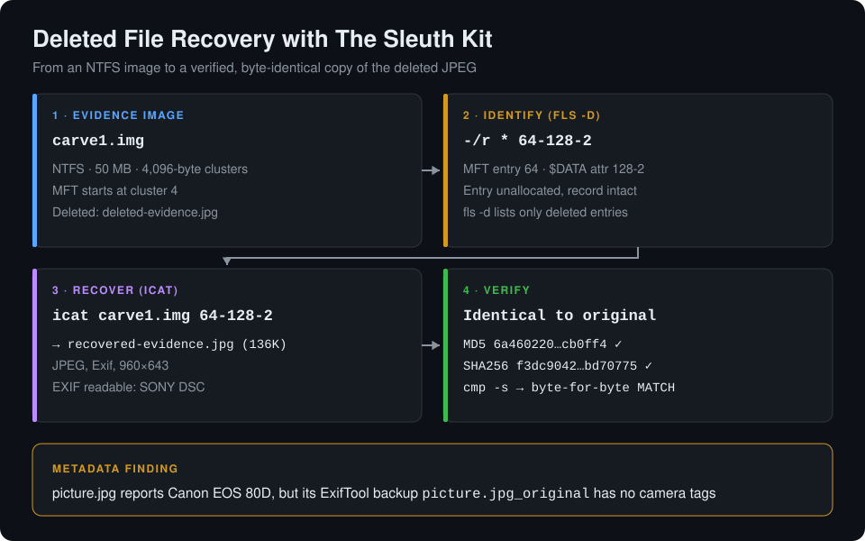
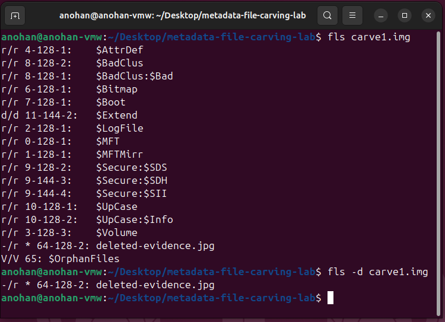
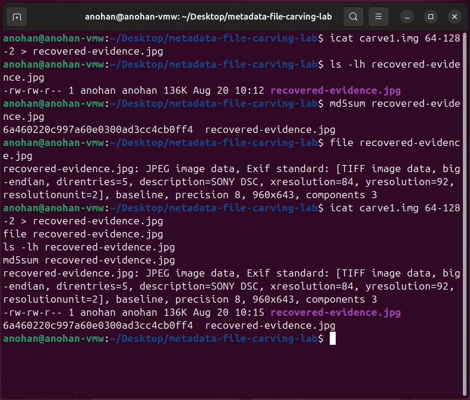
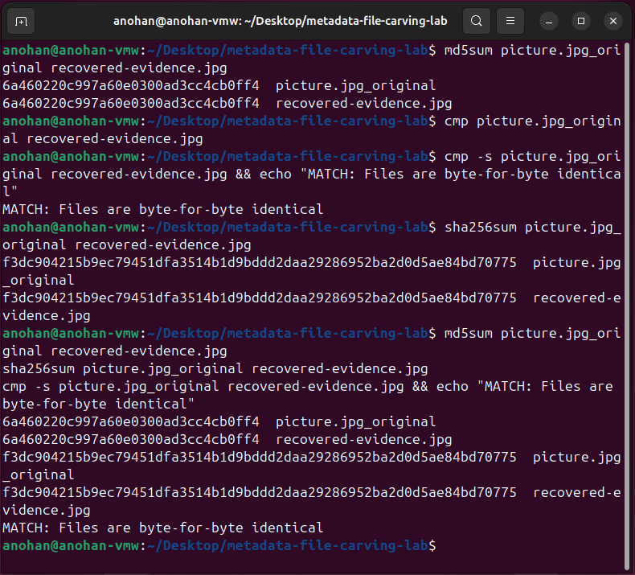
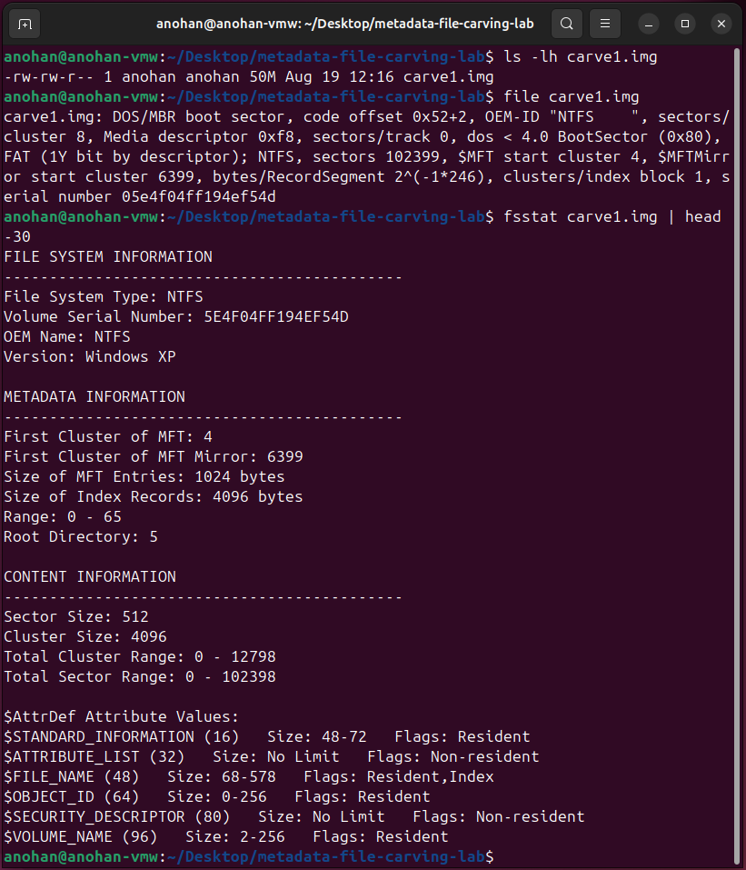
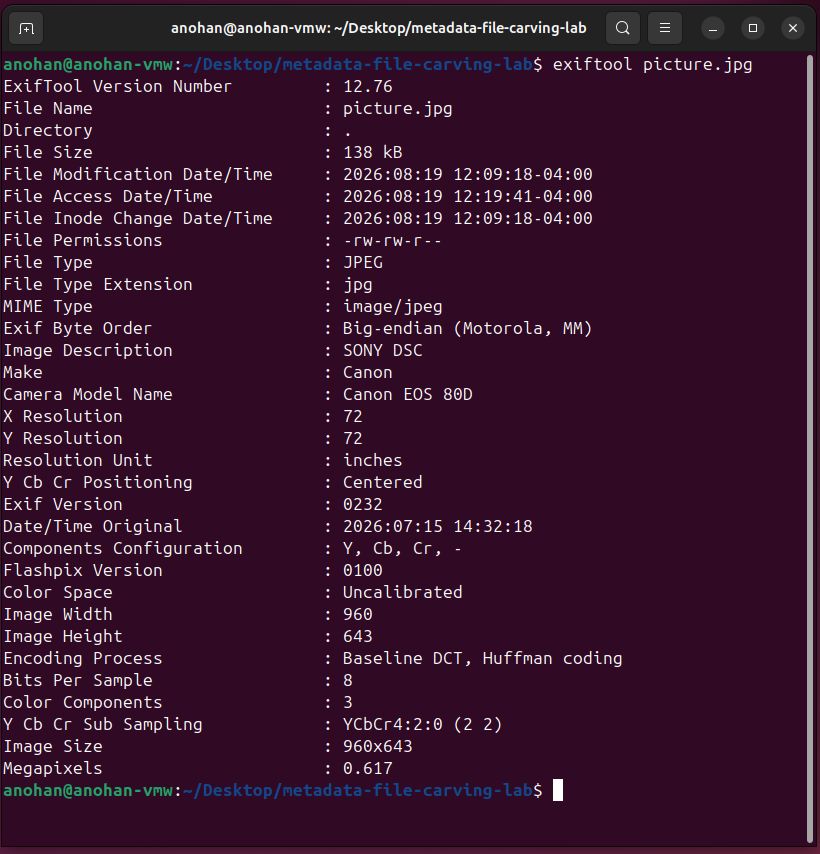
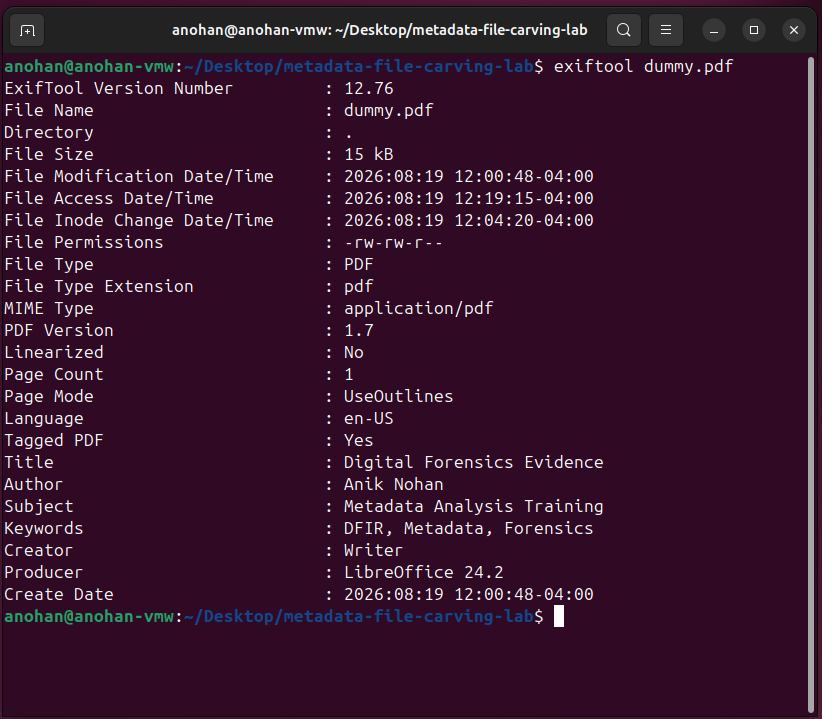
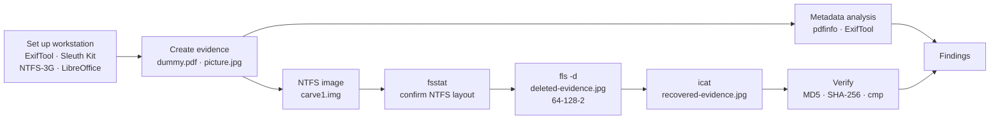

# Digital Forensics: Metadata Analysis & Deleted File Recovery


A hands-on **Linux digital forensics lab** that covers two core examiner skills: **reading metadata** and **recovering deleted files**. I created controlled PDF and JPEG evidence, extracted their metadata with **ExifTool** and `pdfinfo`, then used **The Sleuth Kit** to find a deleted JPEG inside an NTFS image (`carve1.img`), recover it straight from the MFT entry with `icat`, and prove with MD5, SHA-256 and `cmp` that the recovered file is byte-for-byte identical to the original.

> **Result:** `deleted-evidence.jpg` was found at MFT address `64-128-2`, recovered with `icat`, and verified identical to the original (MD5 `6a460220c997a60e0300ad3cc4cb0ff4`). Metadata analysis also showed that the Canon camera tags on `picture.jpg` are absent from its pre-edit backup, a reminder that EXIF can be written as easily as it is read.



## Why I Did This

Metadata and deleted files answer two of the most common questions in an investigation: *who made this and when?* and *what did someone try to get rid of?* I wanted to answer both with open-source command-line tools, the way an examiner would on a Linux forensic workstation, and to finish with proof instead of a claim. Recovering a file is only half the job: showing with hashes and a byte comparison that it is exactly what was deleted is what makes it evidence.

## Highlights

- **Forensic workstation setup:** ExifTool 12.76, The Sleuth Kit 4.12.1, NTFS-3G 2022.10.3 and LibreOffice 24.2 installed and verified on Ubuntu.
- **Controlled document evidence:** a LibreOffice document (Case ID `DFIR-LAB-001`) with known title, subject, keywords and author, exported to `dummy.pdf`.
- **PDF metadata analysis:** `pdfinfo` and ExifTool both confirmed the embedded metadata (PDF 1.7, 1 page, tagged, unencrypted, no JavaScript, Producer LibreOffice 24.2).
- **JPEG EXIF analysis:** description, make, model, original timestamp and dimensions extracted from `picture.jpg`.
- **Metadata integrity finding:** the Canon make, model and DateTimeOriginal tags are missing from `picture.jpg_original`, ExifTool's automatic pre-edit backup.
- **NTFS image examination:** `file` and `fsstat` confirmed NTFS with 4,096-byte clusters, 1,024-byte MFT entries and the MFT at cluster 4.
- **Deleted entry identification:** `fls` and `fls -d` revealed `deleted-evidence.jpg` at `64-128-2`.
- **Recovery from the image:** `icat carve1.img 64-128-2` extracted a valid 960×643 JPEG with readable EXIF.
- **Three-way integrity proof:** matching MD5, matching SHA-256 and a `cmp` byte-for-byte match.
- **Image hash recorded:** SHA-256 of `carve1.img` captured for chain of custody.

## Screenshots

| Deleted entry found with `fls` | Recovery with `icat` |
|---|---|
|  |  |

| Integrity proof: MD5, SHA-256 and `cmp` | NTFS image examined with `fsstat` |
|---|---|
|  |  |

| JPEG EXIF metadata | PDF metadata |
|---|---|
|  |  |

All 15 screenshots are embedded and explained phase by phase in the [project documentation](#project-documentation).

## Evidence Integrity Results

| Evidence | Algorithm | Value |
|---|---|---|
| `picture.jpg_original` | MD5 | `6a460220c997a60e0300ad3cc4cb0ff4` |
| `recovered-evidence.jpg` | MD5 | `6a460220c997a60e0300ad3cc4cb0ff4` |
| `picture.jpg_original` | SHA-256 | `f3dc904215b9ec79451dfa3514b1d9bddd2daa29286952ba2d0d5ae84bd70775` |
| `recovered-evidence.jpg` | SHA-256 | `f3dc904215b9ec79451dfa3514b1d9bddd2daa29286952ba2d0d5ae84bd70775` |
| Original vs recovered | `cmp -s` | `MATCH: Files are byte-for-byte identical` |
| `carve1.img` | SHA-256 | `ae890fcff6d26ea957702c5a4cf38b227336ddad0ae22053aa332208f62deec7` |

## Metadata Findings

| Evidence | Field | Value |
|---|---|---|
| `dummy.pdf` | Title / Subject | Digital Forensics Evidence / Metadata Analysis Training |
| `dummy.pdf` | Author | Anik Nohan |
| `dummy.pdf` | Keywords | DFIR, Metadata, Forensics |
| `dummy.pdf` | Creator / Producer | Writer / LibreOffice 24.2 |
| `dummy.pdf` | Create date | 2026-08-19 12:00:48 −04:00 |
| `picture.jpg` | Image description | SONY DSC |
| `picture.jpg` | Make / Model | Canon / Canon EOS 80D |
| `picture.jpg` | Date/Time Original | 2026:07:15 14:32:18 |
| `picture.jpg` | Dimensions | 960 × 643 |
| `picture.jpg_original` | Make / Model / Date/Time Original | **Not present** |

**Why the last row matters.** ExifTool saves a file's untouched version as `<name>_original` whenever it writes metadata. The backup and the recovered file both lack the Canon and date tags that `picture.jpg` shows, and the `SONY DSC` description contradicts a Canon camera. Together these are consistent with the camera tags having been added afterwards. EXIF is a lead, not proof, until it is corroborated.

## Tools & Technologies

- **Ubuntu Linux:** forensic analysis environment.
- **ExifTool 12.76:** PDF and JPEG metadata extraction and comparison.
- **The Sleuth Kit 4.12.1:** `fsstat` (file-system details), `fls` (file and deleted-entry listing), `icat` (content extraction by metadata address).
- **NTFS-3G / mkntfs 2022.10.3:** NTFS support for building the test image.
- **LibreOffice Writer 24.2:** controlled document creation and PDF export.
- **pdfinfo:** independent PDF metadata check.
- **`file`, `md5sum`, `sha256sum`, `cmp`:** type identification, hashing and byte comparison.

## Investigation Flow



## Investigation Workflow

1. **Prepare the workstation:** install and verify ExifTool, The Sleuth Kit, NTFS-3G and LibreOffice.
2. **Create controlled document evidence:** write a known document and set its title, subject, keywords and author.
3. **Export and verify the PDF:** confirm type and metadata with `file` and `pdfinfo`.
4. **Analyze PDF metadata** with ExifTool.
5. **Analyze JPEG EXIF metadata** with ExifTool.
6. **Examine the NTFS image:** confirm the file system and layout with `file` and `fsstat`.
7. **Identify deleted entries** with `fls` and `fls -d`.
8. **Recover the deleted file** with `icat` using its metadata address.
9. **Validate the recovery:** file type, size and EXIF of the recovered JPEG.
10. **Verify integrity:** MD5, SHA-256 and a byte-for-byte comparison against the original.

## Key Findings

1. **Document metadata survives export.** The title, subject, keywords and author set in LibreOffice all appeared in the PDF, confirmed independently by `pdfinfo` and ExifTool.
2. **EXIF needs corroboration.** `picture.jpg` claims a Canon EOS 80D, but the image description says `SONY DSC` and the pre-edit backup carries no camera tags at all.
3. **Deletion leaves the MFT record behind.** `fls` still listed `deleted-evidence.jpg`, marked `*` as deleted, at address `64-128-2`.
4. **Content was fully recoverable.** `icat` extracted a valid JPEG directly from the image, with no operating-system undelete involved.
5. **The recovery is provably exact.** MD5, SHA-256 and `cmp` all matched the original.

## Repository Structure

```text
digital-forensics-metadata-file-carving-lab/
├── README.md
├── LICENSE
├── assets/
│   └── diagrams/
│       └── deleted-file-recovery-chain.svg
└── evidence/
    └── screenshots/                        # each folder has a README explaining its screenshots
        ├── 01-environment-setup/           # 01–04  tool installation and verification
        ├── 02-pdf-evidence/                # 05–08  document creation and PDF metadata
        ├── 03-jpeg-metadata/               # 09     JPEG EXIF analysis
        ├── 04-ntfs-forensic-image/         # 10     NTFS image examination
        ├── 05-deleted-file-recovery/       # 11, 12, 14  fls, icat, recovered EXIF
        └── 06-integrity-verification/      # 13, 15 hashes, cmp, final summary
```

## Project Documentation

| Phase | Document | What it covers |
|---|---|---|
| 01 | [Environment Setup](evidence/screenshots/01-environment-setup/README.md) | Installing and verifying the forensic toolset |
| 02 | [PDF Evidence](evidence/screenshots/02-pdf-evidence/README.md) | Controlled document, metadata configuration, PDF analysis |
| 03 | [JPEG Metadata](evidence/screenshots/03-jpeg-metadata/README.md) | EXIF extraction and the camera-tag inconsistency |
| 04 | [NTFS Forensic Image](evidence/screenshots/04-ntfs-forensic-image/README.md) | `file` and `fsstat` examination of `carve1.img` |
| 05 | [Deleted File Recovery](evidence/screenshots/05-deleted-file-recovery/README.md) | `fls`, `icat` and recovered-metadata comparison |
| 06 | [Integrity Verification](evidence/screenshots/06-integrity-verification/README.md) | MD5, SHA-256, `cmp` and the final evidence summary |

## How to Review

1. **Start with the result:** the diagram and the [Evidence Integrity Results](#evidence-integrity-results) table.
2. **Follow the recovery:** [Deleted File Recovery](evidence/screenshots/05-deleted-file-recovery/README.md) shows each command and its output.
3. **Check the proof:** [Integrity Verification](evidence/screenshots/06-integrity-verification/README.md) shows the matching hashes and `cmp` result.
4. **See the metadata reasoning:** [JPEG Metadata](evidence/screenshots/03-jpeg-metadata/README.md) explains why the Canon tags should not be trusted on their own.

## Skills Demonstrated

- **Metadata analysis:** PDF document properties and JPEG EXIF with ExifTool and `pdfinfo`.
- **Critical evaluation of metadata:** spotting contradictory and later-added tags.
- **NTFS file-system analysis:** cluster size, MFT location and entry size with `fsstat`.
- **Deleted-file identification:** reading `fls` output and NTFS metadata addresses.
- **Deleted-file recovery:** extracting content by MFT address with `icat`.
- **Evidence integrity:** MD5 and SHA-256 hashing plus byte-level comparison.
- **Linux command-line forensics:** a full workflow with open-source tools.
- **Forensic documentation:** phase-by-phase evidence with commands, output and analyst notes.

## Roadmap

- Carve the JPEG from unallocated space by file signature (`FF D8 … FF D9`) with Foremost or Scalpel, without relying on the MFT record
- Use `istat` on MFT entry 64 to show the deleted file's timestamps and data runs
- Overwrite the deleted file's clusters and show where recovery stops working
- Build a timeline of the image with `fls -m` and `mactime`
- Add GPS-tagged and stripped-metadata JPEGs to the EXIF comparison

---

## Disclaimer

This project was performed entirely in a controlled lab environment for education, digital forensics training and portfolio purposes. All evidence files, images, metadata, deletions and recoveries were created for this exercise. No real-world systems or third-party data were accessed.

---

## Author

**Anik Nohan**

This lab was built to practise and demonstrate real-world digital forensics skills in:

- PDF and JPEG metadata analysis
- NTFS file-system examination
- Deleted-file identification and recovery with The Sleuth Kit
- Evidence integrity verification with MD5, SHA-256 and byte comparison
- Forensic documentation

Also see my **[Windows File System Forensics Lab](https://github.com/aniknohan/windows-file-system-forensics-ftk-imager-lab)**, **[Windows DFIR Security Event Investigation](https://github.com/aniknohan/windows-dfir-security-event-investigation)** and **[Phishing Email Investigation Portfolio](https://github.com/aniknohan/phishing-email-investigation-soc-portfolio)**.

### Tools Used

`ExifTool` • `The Sleuth Kit` • `fsstat` • `fls` • `icat` • `NTFS-3G` • `LibreOffice` • `pdfinfo` • `md5sum` • `sha256sum` • `cmp`

## License

Released under the [MIT License](LICENSE).
